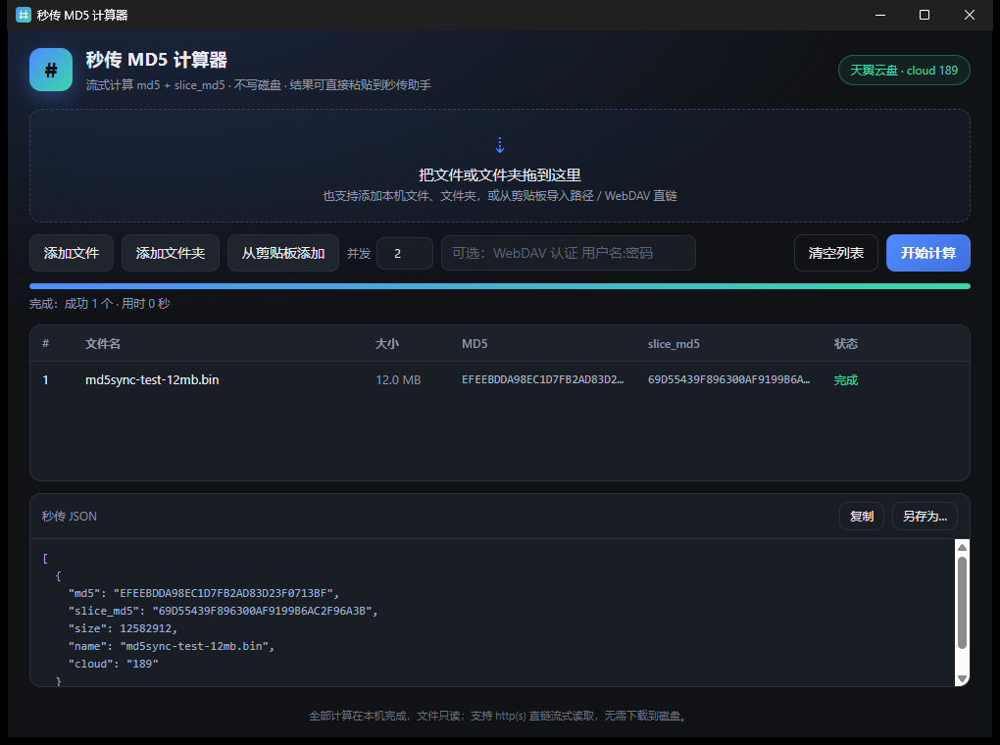

# 秒传 MD5 计算器


给天翼云盘「秒传」准备校验值的本地工具。把文件拖进窗口，程序流式算出 `md5` 与 `slice_md5`，生成 JSON 并自动复制到剪贴板，粘贴到网页端的秒传助手即可完成秒传。

- 单文件 exe，双击即用，无需安装 Python、.NET 运行时等任何依赖
- 全程流式读取，**不写临时文件**，内存占用固定（4 个 4 MB 缓冲轮流复用，约 16 MB）
- 整文件 MD5 与分片 MD5 由两个 goroutine 并行计算，读一遍数据同时算两份哈希
- 支持本地文件、文件夹递归、通配符，以及 openlist / WebDAV 直链
- 多文件并发计算，实时显示每个文件的进度与总速度
- 输出格式与 [天翼云盘秒传助手（Greasyfork 577019）](https://greasyfork.org/zh-CN/scripts/577019) 完全兼容



---

## 一、适用范围

**适合：**

- 已有大量本地影视、音乐、软件安装包，想批量「秒传」进天翼云盘，避免重复上传；
- 文件放在 openlist / Alist / WebDAV 后面，希望远程流式读取、不落本地磁盘；
- 机械硬盘或 NAS 上的大文件（几 GB 到几十 GB 的蓝光原盘）；
- 需要把校验值交给脚本、自动化流程处理（命令行版输出纯 JSON）。

**不适合：**

- 其它网盘（115、百度网盘等）的秒传——它们的校验规则不同，本工具只实现天翼云盘 `cloud=189` 的规则；
- 想通过「秒传」绕过内容审核或分享限制——秒传只建立已有文件的引用，文件本身仍需存在于服务端；
- 需要修改文件内容的场景——本工具只读文件，不会以任何方式改动原文件。

**一个前提：** 秒传能否命中，取决于天翼云盘服务端是否已存在完全相同的内容。计算只是把你的文件「指纹」算出来，命中与否由服务端决定。

---

## 二、工作原理

### 1. 秒传是什么

网盘服务端会按文件内容做去重。客户端提交一组校验值，服务端比对后如果发现库里已有一模一样的文件，就直接在你的目录下建立一条引用，**一个字节都不用上传**，因此称为「秒传」。

天翼云盘需要四个字段：

| 字段 | 含义 |
| --- | --- |
| `md5` | 整个文件的 MD5，32 位**大写**十六进制 |
| `slice_md5` | 分片 MD5 的再聚合值，32 位**大写**十六进制 |
| `size` | 文件字节数 |
| `name` | 目标文件名，不含路径 |
| `cloud` | 固定为字符串 `"189"` |

### 2. slice_md5 的计算规则

依据天翼开放平台文档 `api_detail_716`，计算分三步：

1. 按文件大小查表得到分片大小 `sliceSize`；
2. 按 `sliceSize` 把文件切片，每片单独计算 MD5，结果转成**大写**；
3. 把所有分片 MD5 用换行符 `\n` 连接，再对这段字符串做一次 MD5，转大写，得到 `slice_md5`；
4. 特殊情况：文件不超过 10 MB 时，`slice_md5` 直接等于 `md5`。

分片大小查表：

| 文件大小 | sliceSize |
| --- | --- |
| < 1000 × 10 MB（约 9.77 GB） | 10 MB |
| < 1000 × 20 MB（约 19.53 GB） | 20 MB |
| < 2000 × 50 MB（约 97.66 GB） | 50 MB |
| 更大 | `n = size ÷ (2000 × 10 MB) + 1`，sliceSize = `n × 10 MB` |

举例：一个 12 MB 的文件，`sliceSize = 10 MB`，切成 10 MB + 2 MB 两片；两片的 MD5（各 32 位大写）用 `\n` 拼接后做 MD5，得到 `slice_md5`。

> 网上部分旧教程写的是 256 KB 分片，那是天翼云盘早期接口的规则，现在已不适用。

### 3. 程序怎么算

- 以只读方式打开文件（或 HTTP 流），用 4 MB 缓冲顺序读取一遍；
- 每次读到的数据同时交给两个消费者：一个维护整文件 MD5，一个按 `sliceSize` 切分维护分片 MD5；
- 两个哈希分属不同 goroutine，因此读一遍数据就能并行算出两份结果（单条 MD5 是链式的无法拆分，但两份 MD5 可以并行），比串行计算快约一倍；
- 分片写满 `sliceSize` 就结算成一段大写十六进制，继续下一片；
- 直到文件读完，再按上面的规则聚合出 `slice_md5`；
- 每 200–300 ms 通过回调上报一次进度，界面据此刷新进度条与速度。

整个过程只顺序读一遍，没有第二次遍历，也不缓存文件内容。

### 4. 为什么用 Go

这类工具的性能瓶颈是磁盘 / 网络 I/O 与 MD5 运算本身，换语言不会让计算变快（同一块盘读出的字节数相同，MD5 都走经过优化的底层实现）。选择 Go 是为了交付形态：

| 方案 | 体积 | 启动 | 依赖 | 杀软误报 |
| --- | --- | --- | --- | --- |
| PowerShell 脚本 | 几十 KB | 快 | Windows 自带 | 少 |
| Python + PyInstaller | 15–40 MB | 1–3 秒 | 无 | 较多 |
| **Go 单文件 exe** | **约 11 MB** | **< 0.5 秒** | **无** | 较少 |

同时 `go test` + GitHub Actions 可以在云端直接产出可下载的 exe，不需要使用者配置任何环境。

---

## 三、功能

### 图形界面 `md5sync.exe`

- **拖放**：文件、文件夹直接拖入窗口，文件夹自动递归收集；
- **多种添加方式**：添加文件、添加文件夹、从剪贴板批量导入（每行一个路径或链接）；
- **并发可调**：1–8 个文件同时计算，默认 2；
- **实时反馈**：总进度条、每个文件的百分比、平均速度、已用时间；
- **错误隔离**：单个文件失败（权限、路径不存在、网络中断）不影响其它文件，原因显示在状态列；
- **结果处理**：完成后自动复制 JSON，可再次「复制」或「另存为…」；
- **远程支持**：粘贴 `http(s)` 直链流式计算，需要认证时填写 `用户名:密码`。

### 命令行 `md5calc.exe`

| 参数 | 说明 |
| --- | --- |
| `-t N` | 并发数，默认 `min(4, CPU 核心数)` |
| `-auth U:P` | 访问 WebDAV / 需要 Basic 认证的直链时使用 |
| `-o FILE` | 额外把 JSON 写入文件 |
| `-clip` | 从剪贴板读取待处理路径（每行一个） |

- 不带参数时默认读取剪贴板；
- 支持通配符（`*.mkv`）与文件夹递归；
- 结果以 JSON 数组输出到标准输出，同时自动复制到剪贴板；
- 退出码：`0` 全部成功、`1` 没有成功结果、`2` 部分文件失败，便于脚本判断。

### 输出格式

单个和多个文件统一输出 **JSON 数组**，可整段粘贴到秒传助手：

```json
[
  {
    "md5": "EFEEBDDA98EC1D7FB2AD83D23F0713BF",
    "slice_md5": "69D55439F896300AF9199B6AC2F96A3B",
    "size": 12582912,
    "name": "电影.mkv",
    "cloud": "189"
  }
]
```

---

## 四、使用方法

### 1. 图形界面

1. 双击 `md5sync.exe`（首次运行如被 SmartScreen 拦截，选择「更多信息 → 仍要运行」）；
2. 把视频文件或整个剧集文件夹拖进窗口，也可以点「添加文件 / 添加文件夹 / 从剪贴板添加」；
3. 按硬盘类型设置并发数：机械盘建议 1–2，SSD 建议 2–4；
4. 点「开始计算」，等待状态变为「完成」；
5. JSON 已自动复制，去网页端秒传助手粘贴并开始。

### 2. 命令行

```powershell
# 单个文件
.\md5calc.exe "D:\Movies\流浪地球.mkv"

# 整个文件夹递归，4 个并发
.\md5calc.exe -t 4 "D:\Movies\Breaking Bad S02"

# 通配符，并把结果写入文件
.\md5calc.exe -o result.json "D:\Movies\*.mkv"

# 直接计算 WebDAV 直链（流式读取，不下载到本地）
.\md5calc.exe -auth "admin:123456" "http://127.0.0.1:5244/dav/电影/a.mkv"

# 不带参数：读取剪贴板中的多行路径
.\md5calc.exe
```

### 3. 与网页端秒传助手配合

1. 浏览器安装 [秒传助手脚本](https://greasyfork.org/zh-CN/scripts/577019)；
2. 打开天翼云盘网页版，进入目标文件夹；
3. 在脚本面板中粘贴本工具生成的 JSON，确认目标目录；
4. 点击开始，命中秒传的文件会立即出现在网盘中，不消耗上传带宽。

> 若粘贴后提示格式错误，请确认为 JSON 数组（本工具默认即数组），以及文件名中没有被破坏的特殊字符。

### 4. 处理 openlist / 远程大文件

两种方式都不会把文件落到本地磁盘：

1. **直接粘贴直链（推荐）**：把 openlist 的直链或 WebDAV 地址粘进输入框或命令行，需要认证时填写 `用户名:密码`；
2. **挂载成本地盘**：用 rclone 把 openlist 的 WebDAV 挂成盘符（建议 `--vfs-cache-mode off`），在界面里直接选文件；程序读取时流式拉取，读完即释放。

实测同一条 1.2 GB 的视频，直链模式约 47 MB/s，经 rclone 挂载约 31 MB/s，直链少一层 FUSE 转发、大约快 50%，所以远程文件优先用直链。若必须用挂载盘，可给 rclone 加大预读：

```powershell
rclone mount openlist: L: --vfs-cache-mode off --buffer-size 32M --vfs-read-ahead 128M
```

> 校验需要完整读取一遍文件内容，远程读取会消耗相应的下载流量，请结合自己的流量套餐评估。命中秒传时，上传流量为 0。

---

## 五、常见问题

**计算要多久？**
取决于顺序读取速度：机械盘约 100–200 MB/s，SATA SSD 约 500 MB/s，NVMe 可达 2 GB/s 以上。100 GB 的文件在机械盘上大约需要 8–15 分钟。

**并发数开多大合适？**
机械盘同时读多个文件会因寻道互相拖慢，建议 1–2；SSD/NVMe 建议 2–4；局域网 WebDAV 受带宽限制，加到 4 以上通常没有收益。

**为什么算远程文件明显更慢？**
此时瓶颈是网盘的下载速度（常见 20–50 MB/s），不是本机计算。建议改用「直链」而不是 rclone 挂载盘，实测约快 50%；也可以先秒传一批小文件再处理大文件。

**为什么 `slice_md5` 和 `md5` 一样？**
文件不超过 10 MB 时，规则规定两者相等，属于正常结果。

**算出的值和网页端不一致？**
先确认文件未被修改，再确认工具版本一致（分片规则可能随接口更新）。本项目对分片边界（10 MB、20 MB、50 MB 及临界值）有单元测试，并与独立的朴素实现交叉校验。

**会上传或泄露我的文件吗？**
不会。程序只在本机读取文件并计算，不发起任何网络请求（除非你主动输入了 `http(s)` 直链）。

**支持几十 GB 的原盘吗？**
支持。全程流式读取，内存固定占用约 16 MB，不生成任何临时文件。

**exe 被杀毒软件报毒？**
未签名的小工具容易被启发式误报。可将其加入白名单，或按下一节自行构建，也可以直接使用 GitHub Actions 构建出的产物。

**支持 macOS / Linux 吗？**
Wails 本身支持多平台，但剪贴板模块目前只有 Windows 实现，命令行版可在其它平台自行编译使用。当前以 Windows 为主要目标平台。

---

## 六、构建与发布

环境要求：Go 1.26+、Windows 10/11。前端是纯静态文件，**不需要 Node.js**。

### 本地构建

```powershell
# 测试 + 命令行版
go vet ./...
go test ./...
go build -trimpath -ldflags "-s -w" -o dist\md5calc.exe ./cmd/md5calc

# 安装 Wails CLI（只需一次）
go install github.com/wailsapp/wails/v2/cmd/wails@v2.17.1

# 构建图形界面，产物在 build\bin\md5sync.exe
wails build -s -skipbindings -m -clean
```

参数含义：`-s` 跳过前端构建（`web/` 通过 `go:embed` 直接打进 exe）、`-skipbindings` 不生成 TypeScript 绑定、`-m` 跳过 `go mod tidy`。

自定义信息：窗口标题、版本号、公司名在 `wails.json` 的 `info` 字段中修改；图标替换 `build/appicon.png`（256×256 PNG）即可。

### GitHub Actions

仓库内置 [.github/workflows/build.yml](.github/workflows/build.yml)：

- push 到 `main` 或提交 PR：自动执行 `vet`、`test`，构建 `md5sync.exe` 与 `md5calc.exe`，可在 Actions 页面下载 artifact；
- 推送 `v*` 标签：自动创建 Release 并附上两个 exe。

上传步骤：

```powershell
git init
git add .
git commit -m "init: 秒传 MD5 计算器"
git branch -M main
git remote add origin https://github.com/<你的用户名>/<仓库名>.git
git push -u origin main

# 发版
git tag v1.0.0
git push origin v1.0.0
```

> 注意：仓库根目录必须是本目录（`go.mod` 所在层），Actions 才能正确找到构建配置。

---

## 七、目录结构

```
md5sync/
├── main.go                 图形界面入口（embed web/、窗口配置、拖放）
├── app.go                  界面后端：开始计算、复制/保存 JSON、文件选择
├── core/
│   ├── hash.go             算法核心：分片查表、流式 MD5、进度回调
│   └── hash_test.go        边界用例与朴素实现交叉校验
├── internal/
│   ├── clip/               Windows 剪贴板读写（其它平台空实现）
│   └── scan/               路径展开：通配符、文件夹递归、URL、去重
├── cmd/md5calc/main.go     命令行版
├── web/                    前端页面（index.html / app.js / style.css）
├── build/appicon.png       应用图标
├── docs/screenshot.png     README 截图
├── wails.json              Wails 项目配置
└── .github/workflows/      GitHub Actions 构建与发布
```

---

## 八、许可证

[MIT](LICENSE)
